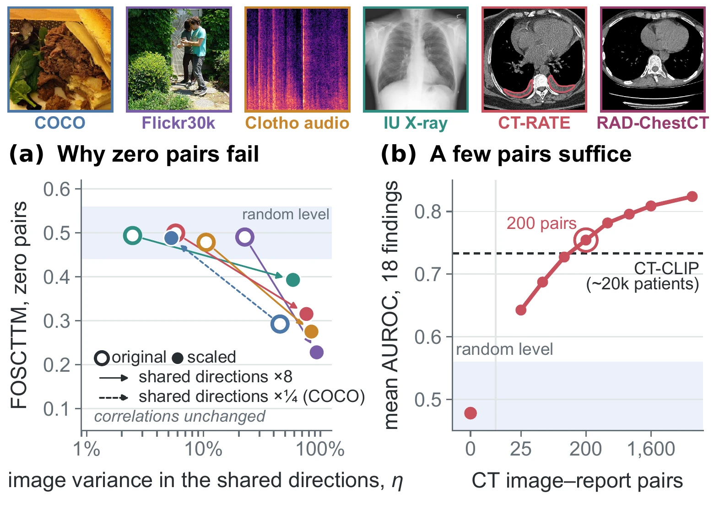

<div align="center">

# What Matters for Cross-Modal Alignment

Yipeng Sun<sup>1</sup>, Jiajun Wang<sup>1</sup>, Siyuan Mei<sup>1</sup>, Yan Xia<sup>2</sup>, Siming Bayer<sup>1</sup>, Vincent Christlein<sup>1</sup>, Andreas Maier<sup>1</sup>

<sup>1</sup>Pattern Recognition Lab, FAU Erlangen-Nürnberg &nbsp; <sup>2</sup>Department of Orthodontics and Orofacial Orthopedics, FAU Erlangen-Nürnberg

[](https://arxiv.org/abs/2611.20000)
[](https://www.alphaxiv.org/abs/2611.20000)
[](https://sypsyp97.github.io/lightalign/)
[](https://huggingface.co/yipengsun/lightalign-ctrate)
[](LICENSE)
[](weights/README.md)



</div>

## TL;DR

- Zero-pair alignment of frozen image and text encoders works on COCO and fails on Flickr30k, Clotho audio, chest radiographs, and 3D CT.
- It fails because the shared subspace carries too little variance to be located without pairs. A located subspace can also be mirrored; skewness fixes the sign.
- **LightAlign** is ridge regression between two frozen encoders, plus a finding classifier fitted on report text alone. It fits in about a minute on four CPU cores.

| | LightAlign | Reference |
|---|:---:|:---:|
| CT-RATE, 200 pairs | **0.754** | 0.733 CT-CLIP (end to end) |
| CT-RATE, all 5,994 pairs | **0.824** | 0.816 COLIPRI |
| RAD-ChestCT (other hospital), 100 CT-RATE pairs | **0.636** | 0.629 CT-CLIP |
| CheXpert, about 5 % of the MIMIC-CXR pairs | **0.862** | 0.889–0.923 trained on MIMIC-CXR |

Mean AUROC. Both encoders stay frozen (CT: VoxelFM × Qwen3.5-9B; radiographs: RAD-DINO × Qwen3.5-4B).

## Quick start

Score a chest CT with the released weights. You need a CUDA GPU and a [VoxelFM](https://github.com/rmaguado/VoxelFM) checkout; the language model is not needed.

```bash
git clone https://github.com/sypsyp97/lightalign && cd lightalign
pip install -e .
lightalign-predict --ct volume.nii.gz --weights weights/ --voxelfm-code /path/to/VoxelFM
```

The output has one row per finding (18 CT-RATE findings): `TC` is the report-classifier score and `P` the prompt score. Neither is a probability. `--weights yipengsun/lightalign-ctrate` loads the same files from Hugging Face. Preprocessing and limitations: [`weights/README.md`](weights/README.md).

## Repository

```
align/        one module per experiment: python -m align.<module> --help
lightalign/   the released CT-RATE model as a package (lightalign-predict)
weights/      fitted map and report classifiers (30 MB) + model card
results/      CSV/JSON behind every table and figure of the paper
scripts/      weight fitting, table reproduction, checks
tests/        pytest suite
```

<details>
<summary><b>Rebuild the weights and the CT-RATE pair-count table</b></summary>

```bash
python scripts/embed_ctrate.py cases  --ctrate /path/to/CT-RATE --out embeddings
python scripts/embed_ctrate.py images --ctrate /path/to/CT-RATE --out embeddings
python scripts/embed_ctrate.py texts  --out embeddings
python scripts/fit_release.py --train embeddings/train --out weights/lightalign-ctrate-n5994-seed0.npz
python scripts/reproduce_table.py --train embeddings/train --valid embeddings/valid
```

`reproduce_table.py` refits n = 50, 100, 200, 400, 1,600 (seeds 0–4) and 5,994 pairs (seed 0) and prints mean AUROC, weighted F1, and accuracy on the 3,002 chest volumes of the CT-RATE validation split.

</details>

<details>
<summary><b>Full setup for all experiments</b></summary>

1. Use Python 3.12 and `pip install -r requirements.txt`.
2. Some encoders need their own repositories on `PYTHONPATH`: VoxelFM, CT-FM (via `lighter_zoo`), DINOv2 and DINOv3, V-JEPA 2, the Wan and LTX VAEs, and the zero-pair aligner of Schnaus et al. (`unpaired-rosetta`, commit `fdfad84`).
3. Audio encoders run in a separate environment with `transformers==4.51.3` and `torchaudio`.
4. Paths: `LIGHTALIGN_DATA` (default `./data`; subdirectories `ct-rate/dataset`, `rad-chestct`, `abdomenatlas3-mini`, `abdomenatlas3-mini/volumes_1mm`) and `LIGHTALIGN_MODELS` (default `./models`, encoder weights).

The datasets are not included. Request access from their providers under their licenses: CT-RATE, RAD-ChestCT, CheXpert Plus, MIMIC-CXR, IU X-ray (Open-i), Flickr30k, COCO, Clotho, BIMCV-R, and AbdomenAtlas 3.0.

Run order: feature extraction → zero-pair analyses → detection threshold → LightAlign and baselines. Tests: `pytest tests`.

| Paper part | Modules |
|---|---|
| Feature extraction | `align.ctrate`, `align.radchest`, `align.domains`, `align.coco`, `align.chexpert`, `align.audio_feats`, `align.zoo` |
| Zero-pair analyses | `align.rosetta`, `align.minivec2vec`, `align.fshare`, `align.gauss`, `align.mknn`, `align.decisive` |
| Detection threshold | `align.spiked`, `align.budget`, `align.planner`, `align.pilot_curve`, `align.pilot_baselines`, `align.domain_scaling`, `align.retrieval_rk` |
| LightAlign and baselines on CT | `align.official`, `align.official_ablation`, `align.official_matrix`, `align.fewpair`, `align.sotalign_protocol*`, `align.ctclip_rerun`, `align.thresh_metrics` |
| Chest X-ray | `align.chexpert_payoff`, `align.chexpert_thresh` |
| Out-of-distribution datasets | `align.radchest_eval`, `align.external`, `align.bimcv` |

</details>

<details>
<summary><b>Paper numbers and their result files</b></summary>

Paths are relative to `results/`. CT-RATE rows use the 3,002 chest volumes, the mean AUROC over 18 findings, and the report classifier (`reader=TC`) unless stated. Rows of other methods without a file are cited from their papers.

| Paper | Result files | Produced by |
|---|---|---|
| Table 1, ours, AUROC | `official_ablation/voxelfm_b11_9B_ablation.csv` | `align.official_ablation run` / `summary` |
| Table 1, ours, F1 and accuracy | `thresh_metrics/thresh_metrics_rows.csv`; 0 pairs: `fewpair_scores/thresh_metrics_fewpair.csv` | `align.thresh_metrics` |
| Table 1, ours, RAD-ChestCT | `radchest/voxelfm_b11_9B_n*.csv` (rows `centring=ctrate`) | `align.radchest_eval main` / `summary` |
| Table 1, SOTAlign and Hadgi | `fewpair/official_{sotalign,hadgi}__*.csv`, `fewpair_rad/rad_*.csv`, `fewpair_scores/thresh_metrics_fewpair.csv` | `align.fewpair official` |
| Table 1, CT-CLIP rerun | `v2-2026-10-30/ctclip_rerun_*_tail.log`, `thresh_metrics/thresh_metrics.csv` | `align.ctclip_rerun`, `align.thresh_metrics` |
| Table S1, CheXpert | `chexpert_payoff/rad_dino_4B_n0_test.csv`, `chexpert_payoff_30k/*_test.csv`, `chexpert_payoff_scale/base/*_test.csv` | `align.chexpert_payoff run` |
| Table 2, domains | `fshare/*.csv`, `rosetta/*.csv` | `align.fshare`, `align.rosetta ours` |
| Table 3, ablation | `official_ablation/voxelfm_b11_9B_ablation.csv` (`reader=P`), `fewpair/official_{mlp_infonce,image_probe_cv}__*.csv`, `select/*.csv` | `align.official_ablation`, `align.fewpair official`, `align.select_config` |
| Detection threshold (figures) | `claim2-spiked/`, `spiked_*/`, `planner/`, `downstream/` | `align.spiked`, `align.planner`, `align.downstream` |
| Other pilot scores | `pilot_baselines/pilot_baselines_summary.csv` (rows `pilot` 200 and 400; checks `S` against `pilot_curve/pilot_curve_m*.csv`) | `align.pilot_curve run`, `align.pilot_baselines run`, `align.pilot_baselines summary` |
| Table S9, fewer reports | `official_ablation_pair_reports/voxelfm_b11_9B_n*.csv` (`reader=TCn`), `official_ablation_report_counts/voxelfm_b11_9B_n200_m*.csv` (`reader=TCm`); `unit=chest`, `metric=mean_auc` | `align.official_ablation run --pair-reports`, `align.official_ablation run --report-count M` |
| Table S2, Schnaus et al. with known pairs | `fewpair/official_wprocrustes__voxelfm_b11__textmid_9B__n*.csv` (`unit=chest`, `metric=mean_auc`) | `align.fewpair official --method wprocrustes` |
| Table S26, tuned image classifier | `fewpair/official_image_probe_cv__voxelfm_b11__textmid_9B__n*.csv` (`reader=IL`; `unit=chest`, `metric=mean_auc`) | `align.fewpair official --method image_probe_cv` |
| Appendix B, paired intervals against Hadgi et al. | `fewpair/ci_ridge_minus_hadgi_b11_9B.csv` (`unit=chest`) | `align.ci_vs_hadgi` (ridge and Hadgi `*_scores.npz` of `align.official_ablation run` and `align.fewpair official`) |
| Appendix F, paired intervals against the tuned image classifier | `fewpair/ci_ridge_minus_probe_cv_b11_9B.csv` (`unit=chest`) | `align.ci_vs_probe` (ridge `*_scores.npz` of `align.official_ablation run`; IL `*_scores.npz` of `align.fewpair official --method image_probe_cv`) |
| Appendix B, RAD-ChestCT interval with 100 pairs | `radchest/boot_n100_ctrate.csv` | `align.radchest_eval main --save-scores`, then `align.rad_ci boot --ns 100 --ref 0.629` (CT-RATE centring) |
| Appendix B, RAD-ChestCT on the 14 labels of HLIP | `radchest/hlip14_subset_ctrate.csv` | `align.rad_ci subset` on `align.radchest_eval main` output (CT-RATE centring) |
| Table S27, no block or layer choice | `official_ablation_no_selection/voxelfm_9B_n*.csv`, `voxelfm_b11_9B_last_n*.csv`, `voxelfm_9B_last_n*.csv`; shaded row: `official_ablation/voxelfm_b11_9B_n*.csv` (`reader=TC`; `unit=chest`, `metric=mean_auc`) | `align.official_ablation run --encoder voxelfm` and/or `--text-layer last` |

</details>

## Citation

```bibtex
@article{sun2026whatmatters,
  title   = {What Matters for Cross-Modal Alignment},
  author  = {Sun, Yipeng and Wang, Jiajun and Mei, Siyuan and Xia, Yan and Bayer, Siming and Christlein, Vincent and Maier, Andreas},
  journal = {arXiv preprint arXiv:2611.20000},
  year    = {2026}
}
```

## License

Code: [Apache 2.0](LICENSE). Weights and the result files that hold CT-RATE case identifiers or per-case scores: CC BY-NC-SA 4.0, inherited from CT-RATE. The datasets and the frozen encoders keep their own licenses. Research use only; not for clinical use.
